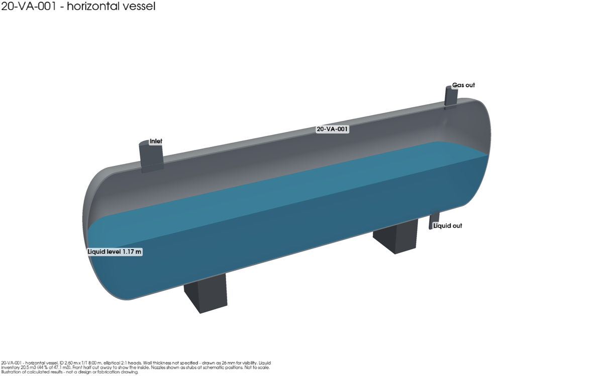
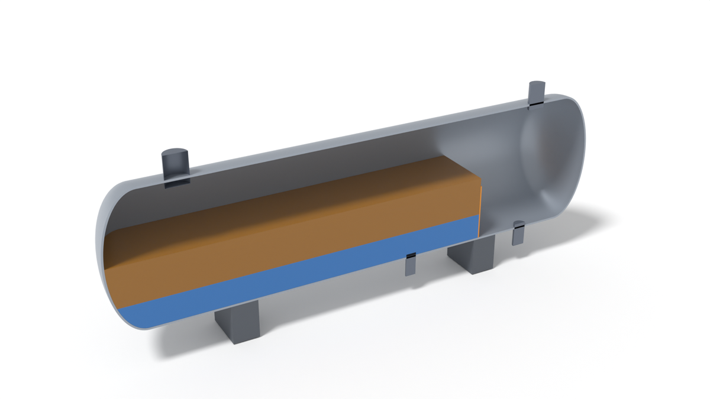
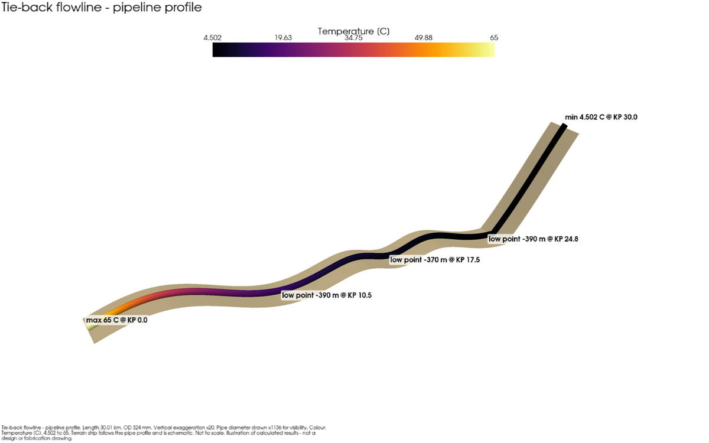
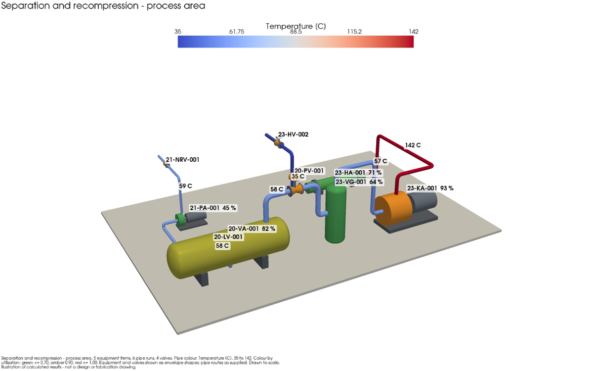
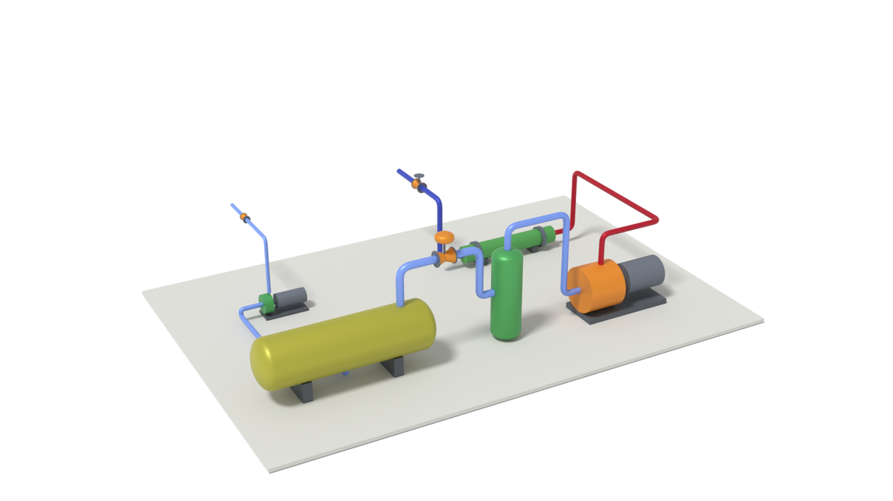
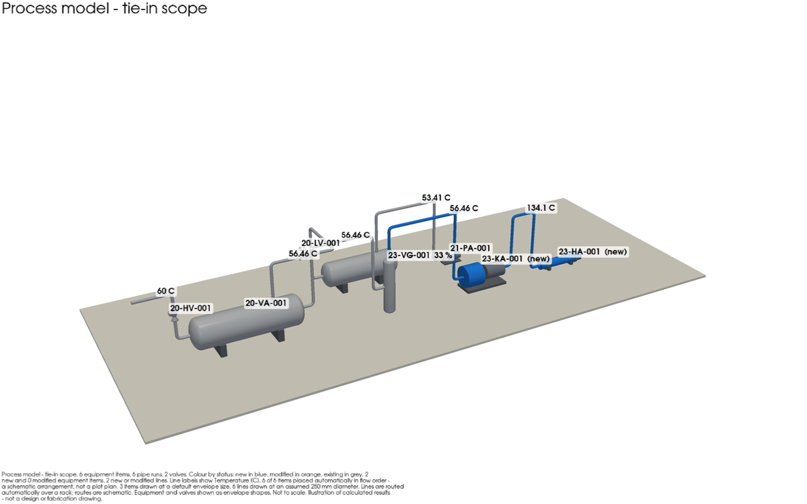
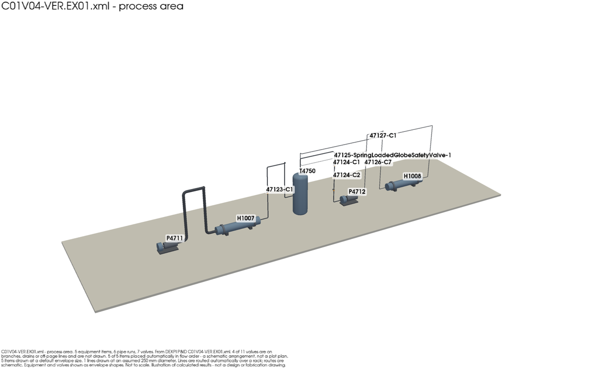
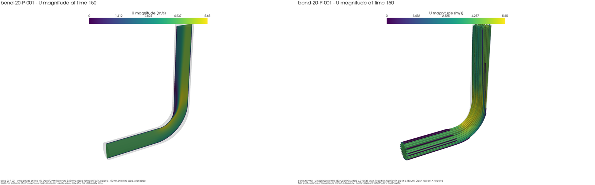

# Engineering 3D Illustration

Turns NeqSim designs and calculated results into 3D figures with open tools:
vessel cutaways with liquid levels, pipelines coloured by a calculated field,
equipment layouts coloured by utilisation, and process areas with equipment,
valves and routed piping. It draws a NeqSim process model or a DEXPI P&ID
directly, marks new and modified items for a tie-in, and draws the fields of a
solved OpenFOAM case.

One scene is built from engineering numbers, then drawn by whichever tool fits:

| Tool | Result |
|---|---|
| [PyVista](https://docs.pyvista.org) | Report figure (PNG) with labels, legend and caption |
| [CadQuery](https://cadquery.readthedocs.io) | STEP, STL and glTF solids |
| [OpenSCAD](https://openscad.org) | Editable `.scad` model |
| [Blender](https://www.blender.org) | Presentation render |

Every tool is optional. Without them the scene, the caption and the generated
scripts are still written, with the command to run them elsewhere.

## Gallery

All images below are produced by the scripts in `examples/` from synthetic data.

A three-phase separator, cut open, with its levels, weir and nozzles (PyVista):



The same scene rendered with Blender:



A 30 km flowline coloured by temperature, with the vertical exaggeration stated:



A process area: equipment coloured by utilisation, pipes by stream temperature,
with control, manual and check valves:





A NeqSim process model drawn straight from `ProcessSystem.buildGraph()`, with the
tie-in scope marked - the new compressor and cooler in blue, stream temperatures
as labels:



The DEXPI reference P&ID read through NeqSim's DEXPI reader and drawn in 3D, with
its tagged equipment, lines and inline valves:



Velocity in a pipe bend from a solved OpenFOAM case - cut plane and streamlines:



## Works with the NeqSim main repository

This skill draws what NeqSim already knows instead of asking for it again:

| From NeqSim | Used for |
|---|---|
| `ProcessSystem.buildGraph()` | Equipment, lines, inline valves, stream values |
| `DexpiXmlReader`, `DexpiTopologyResolver` | A DEXPI P&ID in 3D |
| `CapacityConstrainedEquipment.getMaxUtilization()` | Utilisation on equipment |
| `MechanicalDesign.toDesignDataJson()` | Vessel shell dimensions |
| `neqsim layout-study` dataset | Real equipment positions |

Where no position, size or diameter is available, a default is used and counted
in the caption. An automatic arrangement is a schematic in flow order, not a plot
plan - for placement against clearance and access rules use the plant-layout
skills in the main repository and pass their positions in.

## Install

```bash
python -m pip install -e skills/visualization/engineering-3d-illustration
python -m pip install pyvista      # report figures
python -m pip install cadquery     # STEP / STL / glTF
python -m pip install bpy          # Blender render without a Blender install
```

OpenSCAD and Blender can also be installed as ordinary applications; the skill
finds `openscad` and `blender` on `PATH`.

## Run Examples

```bash
cd skills/visualization/engineering-3d-illustration
python examples/separator_cutaway.py
python examples/pipeline_temperature_profile.py
python examples/module_utilisation_layout.py
python examples/process_area_3d.py --blender
python examples/neqsim_results_to_3d.py                 # needs neqsim and Java
python examples/neqsim_process_and_dexpi_to_3d.py [pid.xml]   # needs neqsim and Java
python examples/openfoam_case_to_figure.py <case_dir> U # needs a solved case
```

Results are written to `examples/output/`. `--blender` adds a Cycles render,
which takes from tens of seconds to minutes on a CPU.

## Run Tests

```bash
python -m pytest skills/visualization/engineering-3d-illustration/tests
```

The geometry, volume, scene and script tests need no optional package. Tests
that draw are skipped when their tool is not installed.

## Public Scope

Shapes are envelopes and positions are as supplied. The figures illustrate
calculated results; they are not design, fabrication or layout drawings, and
they do not replace engineering judgement. A qualified engineer reviews a
figure against the calculation before it is issued. No proprietary data,
vendor geometry or company standards are included.
